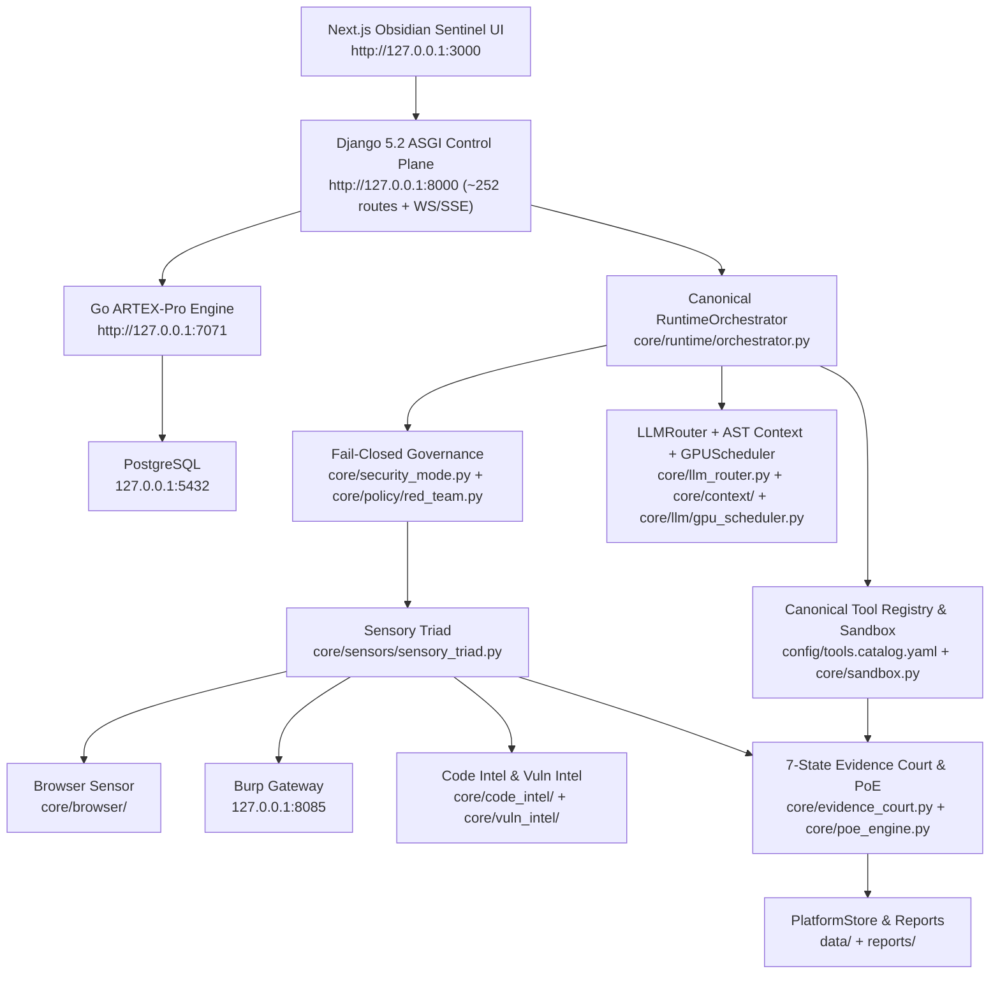

# HunterAI — Autonomous Evidence-Driven Security Testing Platform

[](https://www.python.org)
[](backend/)
[](frontend/)
[](LICENSE)

HunterAI is a multi-stack autonomous penetration testing and bug bounty platform governed by fail-closed security controls, a deterministic Proof-of-Execution (PoE) engine, and a 7-state Evidence Court.

[Overview](#overview) · [Architecture](#architecture) · [Service Topology](#service-topology) · [Core Subsystems](#core-subsystems) · [Quickstart](#quickstart) · [Verification](#verification) · [Documentation](#provenance-isolation--documentation)

---

## Overview

Conventional scanners generate false positives from string reflections and heuristic LLM guesses. HunterAI enforces three deterministic invariants before any finding can reach `CONFIRMED`:

- `Reflection != Execution`
- `Dangerous API Pattern != Vulnerability`
- `Speculative Prediction != Confirmed Finding`

Signals from the Sensory Triad (Playwright Browser, Burp Suite Gateway, and Client/AST Code Intelligence) and external tool adapters enter strictly as hypotheses or observations. Every candidate passes through [`core/evidence_court.py`](core/evidence_court.py) and [`core/poe_engine.py`](core/poe_engine.py), where an independent verifier must satisfy a typed `ProofContract` or causal invariant before adjudication.

---

## Architecture



For full subsystem contracts, state machines, and security boundaries, see [ARCHITECTURE.md](ARCHITECTURE.md) and [docs/security.md](docs/security.md).

---

## Service Topology

| Service | Path | Default Bind / Port | Notes |
| :--- | :--- | :--- | :--- |
| **Obsidian Sentinel UI** | `frontend/` | `http://127.0.0.1:3000` | Next.js App Router (`/`, `/operations`, `/surface`, `/intercept`, `/findings`, `/arsenal`, `/studio`, `/system`); WCAG AA & EN/AR RTL support |
| **Django ASGI Control Plane** | `hunter_backend/` | `http://127.0.0.1:8000` | Pure ASGI + DRF (~252 HTTP routes, WebSockets, SSE); CSPRNG bearer token, CSRF/Origin guard, `userTier` vs `tokenTier` |
| **Go ARTEX-Pro Engine** | `backend/` | `http://127.0.0.1:7071` | Concurrency scan engine (`ARTEX_BIND_ADDR`); constant-time bearer auth, private/metadata SSRF block |
| **PostgreSQL** | `docker-compose.yml` | `127.0.0.1:5432` | Relational store for Go ARTEX-Pro engagements, assets, findings, and audit records |
| **Burp Gateway Bridge** | `core/burp_gateway/` | `http://127.0.0.1:8085` | Local REST bridge for Burp Proxy/Repeater ingestion; loopback-only default + `X-Hunter-Token` / bearer auth |
| **WAF Validation Lab** | `docker-compose.waf-lab.yml` | `http://127.0.0.1:8088` | ModSecurity + OWASP CRS lab endpoint (offset from `:8080` to avoid Burp Suite Proxy collision) |

---

## Core Subsystems

| Subsystem | Canonical Path | Role |
| :--- | :--- | :--- |
| **Runtime Orchestrator** | `core/runtime/orchestrator.py` | Manages `QUEUED -> RUNNING -> WAITING/PAUSED -> COMPLETED/FAILED/CANCELLED` lifecycles, `Flow -> Task -> Subtask` checkpoints, idempotency, and crash recovery (`recover_run`). |
| **7-State Evidence Court** | `core/evidence_court.py`, `core/poe_engine.py` | Multi-party adjudication into `UNVERIFIED`, `CANDIDATE`, `CONFIRMED`, `REJECTED`, `INCONCLUSIVE`, `UNAVAILABLE`, or `ERROR` backed by typed `ProofContract` verification. |
| **Sensory Triad** | `core/sensors/sensory_triad.py`, `core/browser/`, `core/burp_gateway/`, `core/code_intel/` | Correlates Playwright DOM/state events, Burp wire traffic, and JS/AST route and secret extraction. |
| **Vulnerability Intelligence** | `core/vuln_intel/` | Local SQLite CVE/GHSA store with NVD 2.0 and OSV connectors, local CVSS v3 scoring, PHP component classification, project-aware triage, and `/api/vuln-intel/*` endpoints. |
| **Tool Catalog & Sandbox** | `config/tools.catalog.yaml`, `core/tool_registry.py`, `core/sandbox.py` | Single-source catalog (68 tools across 13 tiers + 2 MCP entries), policy-gated dispatch, argv-only subprocess execution, and hardened `DockerSandbox` (`CapDrop: ALL`, `no-new-privileges`, `read_only`, `pids_limit`). |
| **Skills, Prompts & Wordlists** | `skills/registry.json`, `core/prompts/`, `wordlists/pentesterflow/` | Canonical `hunterai-redteam` skill mirrored to `.opencode/skills/` and `.agents/skills/`, dual-channel prompt templates (`ReflectorLoopGuard`), and 8 Apache-2.0 PentesterFlow corpora (`graphql`, `jwt`, `ssti`, `supabase`, `takeover`). |
| **LLM Router, Context & VRAM** | `core/llm_router.py`, `core/context/`, `core/llm/gpu_scheduler.py` | Policy-driven routing (`cloud_first`, `local_first`, `local_only`, `cloud_only`), AST-aware context compaction (`ChainAST`, `CompactionCircuitBreaker`, `TokenAccountant`, tool offload), and process-wide `GPUScheduler` priority locking. |
| **Fail-Closed Governance** | `core/security_mode.py`, `core/policy/red_team.py`, `core/network_scope_guard.py` | Defaults to `unrestricted_mode() == False` and `web_governance_enforced() == True`; HMAC-signed `AuthorizationGrant`, non-overridable hard invariants, and hash-chained audit logs. |
| **Blue-Team Detection Pack** | `detections/` | Isolated static detection library (Sigma atomic & correlation rules, Suricata signatures, ATT&CK Navigator layer, CSV/MISP indicators, and `triage/artex_host_triage.py`). Not loaded by offensive runtime loops. |

---

## Quickstart

### 1. Install Dependencies

```bash
git clone https://github.com/Abdo453/HunterAI.git
cd HunterAI
python3 -m venv venv
source venv/bin/activate  # Windows PowerShell: .\venv\Scripts\Activate.ps1
pip install -r requirements.txt
```

Optional components:
- **Frontend UI (`frontend/`):** Node.js 22 (`cd frontend && npm ci`)
- **Go ARTEX-Pro (`backend/`):** Go 1.26+ (or Go 1.24+ with `GOTOOLCHAIN=auto`; `cd backend && go build ./cmd/server`)
- **Playwright Browser Sensor:** `playwright install chromium` (or `firefox`)

### 2. Launch the Unified Platform

```bash
# Optional: set PostgreSQL password when enabling the Go ARTEX-Pro engine (:7071)
export ARTEX_DB_PASSWORD="<your-postgres-artex-password>"

# Unified stack: PostgreSQL (:5432) + Go ARTEX-Pro (:7071) + Django ASGI (:8000) + Next.js (:3000)
python pentest.py artex target.com

# Web Control Center (Django ASGI :8000 + Next.js :3000)
python pentest.py web target.com

# OpenCode Studio Hub (Next.js :3000/studio + Django ASGI :8000)
python pentest.py opencode target.com

# Headless CLI scan
python pentest.py all target.com

# Direct single-target CLI entry point
python main.py --target https://staging.example.com --mode full
```

On first start, Django generates a local CSPRNG operator token at `data/root_controller/.api_token` (shared with Go ARTEX-Pro). Paste this token into the dashboard's **Platform Authentication Required** banner at `http://127.0.0.1:3000/` to unlock live telemetry, SSE streaming, managed runs, and Copilot.

### 3. Configure LLM Providers

`core/llm_router.py` supports local [Ollama](https://ollama.ai) and cloud providers under `HUNTER_LLM_POLICY` (`cloud_first` default, `local_first`, `local_only`, or `cloud_only`).

```bash
# Configure local Ollama model
python pentest.py setup --provider ollama --model qwen2.5:14b
```

Optional cloud provider environment variables in `.env`: `OPENAI_API_KEY`, `ANTHROPIC_API_KEY`, `GROQ_API_KEY`, `GEMINI_API_KEY`, `DEEPSEEK_API_KEY`, `OPENROUTER_API_KEY`.

### 4. Authorized Red-Team Grants & Safe Detectors

For engagements with explicit written authorization, issue a time-bounded HMAC-signed grant (`core/policy/red_team.py`, documented in [AUTHORIZED_RED_TEAM_MODE.md](AUTHORIZED_RED_TEAM_MODE.md)):

```bash
python scripts/authorize_full_power.py issue --scope "staging.example.com,10.10.0.0/24" --authorized-by "Engagement SOW" --days 7
python scripts/authorize_full_power.py check --target staging.example.com
python scripts/authorize_full_power.py revoke
```

To run the hermetic read-only detector demo (`core/detectors/`, documented in [SAFE_DETECTORS.md](SAFE_DETECTORS.md)):

```bash
python -m core.detectors.cli demo
python -m core.detectors.cli scan --target https://staging.example.com --path /search --param q --class sqli
```

---

## Verification

Run verification gates locally before engaging a target or merging changes. Execute the target suite directly rather than relying on cached counts:

```bash
# Isolation, security hardening, and canonical architecture contracts
python -m pytest tests/test_external_isolation.py tests/security/ tests/test_canonical_runtime_contracts.py tests/test_evidence_court_truthfulness.py tests/test_registry_parity.py tests/test_cross_platform_sandbox.py tests/test_prompt_templates.py tests/test_sensory_triad_and_vuln_intel.py tests/test_llm_context_vram.py -q

# Full hermetic Python test suite (excluding slow/live browser E2E and opt-in integration tests)
python -m pytest tests/ -q -m "not slow" --ignore=tests/integration

# Full-platform hermetic E2E and benchmark suite
python -m pytest tests/integration/test_full_platform_e2e.py -q

# Skill registry & tool catalog manifest parity
python tools/install_opencode_skills.py --check
python scripts/sync_tool_manifests.py --check

# Causal validation arena, readiness check, and pre-engagement certification
python run_causal_validation_arena.py
python -m core.readiness --timeout 5
python certify.py

# Go ARTEX-Pro race-enabled test suite
cd backend && go test -race ./...

# Next.js frontend lint, typecheck, build, and UI gate
cd frontend && npm run lint && npx tsc --noEmit --incremental false && npm run build && npm run verify:ui
```

---

## Provenance, Isolation & Documentation

- **Upstream Isolation & License Policy:** Reference clones under `external/` (`pentesterflow-agent` Apache-2.0 and `pentagi` MIT) are excluded from Git, Docker, Python packaging, pytest discovery, and skill registries. `github.com/vxcontrol/cloud` (AGPL-3.0) is banned and enforced by `tests/test_external_isolation.py`. See [NOTICE](NOTICE).
- **Documentation Index:**
  - [ARCHITECTURE.md](ARCHITECTURE.md) — Unified architecture, runtime lifecycles, and subsystem boundaries
  - [docs/OPERATIONAL_GUIDE.md](docs/OPERATIONAL_GUIDE.md) — Deployment, auth, scope enforcement, and incident workflows
  - [docs/security.md](docs/security.md) & [docs/security_audit.md](docs/security_audit.md) — Verified security controls and hardening log
  - [docs/IMPLEMENTATION_STATUS.md](docs/IMPLEMENTATION_STATUS.md) & [IMPLEMENTATION_ROADMAP.md](IMPLEMENTATION_ROADMAP.md) — Milestone tags (`phase/0-green`–`phase/8-green`) and roadmap
  - [docs/MIGRATION_BASELINE.md](docs/MIGRATION_BASELINE.md) — Phase 0 baseline measurements and upstream commit pins
  - [AGENT_SKILLS_GUIDE.md](AGENT_SKILLS_GUIDE.md) — Skill registry architecture and command routing
  - [KALI_SETUP.md](KALI_SETUP.md) — Kali Linux toolchain setup and environment verification
  - [detections/README.md](detections/README.md) — Isolated Sigma, Suricata, ATT&CK, MISP, and host-triage rules

---

## Legal Notice

HunterAI is intended strictly for authorized penetration testing, bug bounty programs with published safe harbor, and defensive security research. Testing targets without prior explicit authorization is illegal. Operators are solely responsible for compliance with applicable laws and engagement scope.
