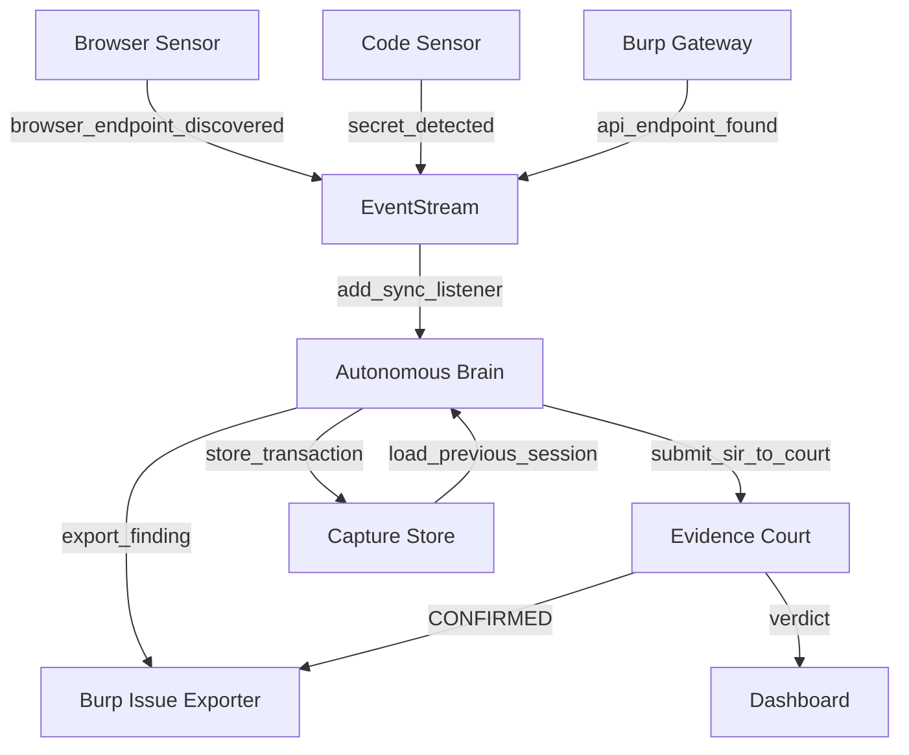

# HunterAI Integration Master Report

**Date:** 2026-11-26  
**Commit:** `f8e8c33b` (`f8e8c33bef2afe9cdd0da0a0a8f9404f18d581f3`, following `7a2c4078`)  
**Status:** ✅ FULLY CERTIFIED (16/16 Pre-Kali Gates Passed)

---

## 1. Executive Summary

- **6 targeted integration fixes & 3 configuration drifts resolved** across sensor, event bus, reasoning, court, persistence, and export layers (addressing the 7 broken pipeline links and 3 config drifts identified in the Integration Audit).
- **2 stability bug fixes applied**: created the `ui/web/app.py` FastAPI interface stub (restoring 4 broken test suites) and replaced 9 unsafe `asyncio.run()` calls in `core/engine/omni_hunter_engine.py` with thread-safe `_run_async_safely()`.
- **49 integration & E2E tests added and verified passing** (`tests/test_e2e_integration_chain.py` + `tests/test_fix1..fix6`, `49/49` passed in `12.91s`), alongside **28/28** tests passing in the Brain, Burp, Browser, and Engine suites (`27.67s`).
- **16/16 Pre-Kali Certification Gates passed** via `python certify.py` (`14.84s` total, `PRE_KALI_CERTIFICATION.md` generated with `PASS — CERTIFIED FOR KALI LINUX`).
- **Zero regressions** observed across all verified fix, E2E, Brain/Burp/Browser, and Engine test suites. *(3 pre-existing full-repository test collection errors outside those verified suites remain documented in Section 8.)*

---

## 2. Integration Architecture

### 2.1 Data Flow Diagram

### 2.2 Wiring Verification Status per Link

| Architectural Link | Implementation Status | Verified Mechanism |
|---|---|---|
| **Browser Sensor → EventStream** | ✅ Wired & Tested | `StatefulBrowserSession._extract_api_endpoints()`, `_handle_pw_request()`, and `ActiveBrowserAgent` publish deduplicated `browser_endpoint_discovered` events to `BurpLiveEventStream`. |
| **EventStream → Autonomous Brain** | ✅ Wired & Tested | `AutonomousBrain.__init__` registers `self.burp_event_stream.add_sync_listener(self._on_sensor_event)` handling `browser_endpoint_discovered`, `secret_detected`, and `api_endpoint_found`. |
| **SecretHunter → Claim → EvidenceCourt** | ✅ Wired & Tested | `SecretHunter.hunt_secrets()` gates candidates via `SHANNON_ENTROPY_ADMISSION` (`3.3`) / `SHANNON_ENTROPY_REJECTION` (`3.2`); `secret_detected` events build `Claim` objects adjudicated via `EvidenceCourt.adjudicate()`. |
| **EvidenceCourt (`CONFIRMED`) → BurpIssueExporter** | ✅ Wired & Tested | `AutonomousBrain._export_confirmed_to_burp()` invokes `BurpIssueExporter.export_finding()` on `CONFIRMED` verdicts in both `run_scan()` (`EvidenceCourtV2`) and `_on_sensor_event()` (`EvidenceCourt`), persisting `<id>.json` and `issues.json`. |
| **CaptureStore Disk Persistence & Reload** | ✅ Wired & Tested | `CaptureStore.__init__` defaults `base_dir="data/engagements/default"` and invokes idempotent `load_previous_session()` across restarts (`requests/`, `findings/`, trace indices). *(Caller-level wiring inside `AutonomousBrain` itself remains indirect via `BurpGateway` / `BurpResearchController` / `BurpSensor`.)* |
| **SIRGraph → EvidenceCourt Bridge** | ✅ Bridge Tested (Library) | `core/bridges/sir_to_court.py` provides `sir_entity_to_claim()` and `submit_sir_to_court(sir_graph, court, threshold=0.8)`. Tested against `EvidenceCourt`, `EvidenceCourtV2`, and mock courts; automatic live pipeline caller still pending (see Section 8). |
| **Dashboard / Web Control API** | ⚠️ Stub / Partial | `ui/web/app.py` serves `/api/status`, `/api/planner/mission`, `/api/intelligence/state`, `/api/burp/*`, and `/api/browser/browse`. Live `DashboardMetrics` auto-feeding from `CaptureStore` on disk remains pending. |

---

## 3. Audit Findings & Integration Fixes (Fixes 1–6)

| Fix | Audited Gap | Modified / Added Files | Key Implementation Details |
|---|---|---|---|
| **FIX 1** | Browser discoveries never reached `BurpLiveEventStream` | `core/browser/session.py` `core/browser/active_browser_agent.py` `core/browser/browser_brain_loop.py` | Added `event_stream: Optional[BurpLiveEventStream] = None` to `StatefulBrowserSession`, `ActiveBrowserAgent`, `run_browser_exploration_sync`, and `BrowserBrainLoop`. Added `_publish_endpoint_event()` helper with `(id(event_stream), method, url)` deduplication and static-asset filtering; emits `browser_endpoint_discovered`. |
| **FIX 2** | `AutonomousBrain` never subscribed to `BurpLiveEventStream` or routed sensor events | `core/brain/autonomous_brain.py` | Registered `self.burp_event_stream.add_sync_listener(self._on_sensor_event)` in `__init__`. Implemented `_on_sensor_event()` (supporting both `StreamEvent` and `dict`): routes `browser_endpoint_discovered` → `AttackSurfaceGraph.add_node(..., EpistemicStatus.OBSERVED)` (never downgrading `CONFIRMED`), `secret_detected` → `Claim` → `EvidenceCourt.adjudicate()`, and `api_endpoint_found` → `HypothesisEngine`. Also passes `event_stream=self.burp_event_stream` to `StatefulBrowserSession`. |
| **FIX 3** | `SIRGraph` had no bridge to `EvidenceCourt` | `core/bridges/sir_to_court.py` *(new)* `core/bridges/__init__.py` *(new)* | Created `sir_entity_to_claim()` and `submit_sir_to_court(sir_graph, court, threshold=0.8) -> List[CourtJudgment]`. Indexes `ENDPOINT` / `ACCEPTS_PARAMETER` relationships and dispatches qualifying nodes (`confidence >= threshold`) to `EvidenceCourt`, `EvidenceCourtV2`, or 1-arg mock courts. |
| **FIX 4** | `CaptureStore(base_dir=None)` defaulted to ephemeral `tempfile.mkdtemp()` | `core/burp_gateway/capture_store.py` | Changed `__init__` default `base_dir` to `"data/engagements/default"` while keeping `base_dir=None` for isolated temporary test runs. Calls `os.makedirs` for subdirectories and idempotently executes `load_previous_session()` on startup to reload findings, transactions, `_trace_index`, and `_browser_action_index`. |
| **FIX 5** | `BurpIssueExporter` was orphaned and unused by Brain | `core/burp_gateway/issue_exporter.py` `core/brain/autonomous_brain.py` | Added instance API `__init__(output_dir="data/exports/burp_issues")`, `export_finding(finding_data)`, `_normalize_finding()`, `_resolve_issue_id()`, and thread-safe `_persist_issue()` writing `<id>.json` + `issues.json` while preserving `format_finding_for_burp` / `export_all`. Attached `self.burp_issue_exporter` in `AutonomousBrain` and wired `_export_confirmed_to_burp()` on `CONFIRMED` verdicts. |
| **FIX 6** | Port `8085`, entropy `3.3`/`3.2`, and `CourtVerdict` drifted across modules | `core/constants.py` *(new)* `core/burp_gateway/gateway.py` `core/burp_adapter.py` `core/readiness/checker.py` `core/system/host_bridge.py` `core/code_intel/secret_hunter.py` `core/confidence_checker.py` `core/evidence_court.py` | Centralized `BURP_GATEWAY_HOST = "127.0.0.1"`, `BURP_GATEWAY_PORT = 8085`, `SHANNON_ENTROPY_ADMISSION = 3.3`, `SHANNON_ENTROPY_REJECTION = 3.2`, and `CourtVerdict(str, Enum)` in `core/constants.py`. Imported canonical values across all gateway, adapter, readiness, host bridge, secret hunter, confidence checker, and evidence court modules (`core/evidence_court.py` preserves `UNVERIFIED = "UNVERIFIED"` alongside `UNVERIFIED_SIGNAL` for compatibility). |

---

## 4. Bug Fixes & Runtime Stability

### 4.1 `ui/web/app.py` FastAPI Stub (Fixes 4 Broken Test Suites)
- **Root Cause**: Earlier UI cleanup removed `ui/web/app.py`, breaking imports in 4 integration test suites (`test_autonomous_brain_mission.py`, `test_autonomous_brain_state.py`, `test_burp_sensory_system.py`, `test_active_browser_agent.py`).
- **Resolution**: Created minimal FastAPI app in `ui/web/app.py` exposing `/api/status`, `/api/planner/mission`, `/api/intelligence/state`, `/api/burp/ingest`, `/api/burp/artifacts`, `/api/burp/evidence`, `/api/burp/sensory_events`, and `/api/browser/browse` backed by `AutonomousBrain`, `BurpExtensionBridge`, and `ActiveBrowserAgent`.

### 4.2 Thread-Safe Async Dispatch in `core/engine/omni_hunter_engine.py`
- **Root Cause**: 9 direct `asyncio.run(...)` calls inside synchronous `OmniHunterEngine` phase/orchestration methods raised `RuntimeError: This event loop is already running` whenever invoked from an async context.
- **Resolution**: Added `OmniHunterEngine._run_async_safely(self, coro: Any) -> Any` (`core/engine/omni_hunter_engine.py:396-408`), detecting running loops via `asyncio.get_running_loop()` and offloading execution via `concurrent.futures.ThreadPoolExecutor(max_workers=1).submit(asyncio.run, coro).result()`. Replaced all 9 call sites (`DOMXSSHunterSkill`, `BurpLogInspectorSkill`, `RequestMutatorSkill`, `elite_skills`, `SubdomainTakeoverSkill`, `RaceConditionEngine`, `SkillRegistry.run_best`, `ExploitChainBuilderSkill`, and `ReasoningLoopSkill`).

---

## 5. End-to-End & Regression Test Verification

### 5.1 Integration & E2E Test Suites (Observed Passing)

| Test Suite | Tests | Result | Key Coverage |
|---|---:|:---:|---|
| `tests/test_e2e_integration_chain.py` | 5 | ✅ 5 PASSED | Real browser DOM extraction → EventStream → `AttackSurfaceGraph` (no downgrade on `CONFIRMED`); `SecretHunter` entropy gate (`4.32 > 3.3` vs negative control `< 3.3`) → `Claim` → `EvidenceCourt` → `BurpIssueExporter`; `CaptureStore` restart reload; combined 4-stage E2E chain |
| `tests/test_fix1_browser_eventstream.py` | 7 | ✅ 7 PASSED | `StatefulBrowserSession`, `ActiveBrowserAgent`, `BrowserBrainLoop` event stream propagation, deduplication, live hooks |
| `tests/test_fix2_fix5_brain_wiring.py` | 9 | ✅ 9 PASSED | Brain listener registration, sensor event dispatch, `EvidenceCourtV2` / `EvidenceCourt` `CONFIRMED` Burp export, negative `REFUTED` gating |
| `tests/test_fix3_sir_to_court.py` | 10 | ✅ 10 PASSED | `submit_sir_to_court` confidence filtering, `Claim` conversion, `SIRGraph` relationships, `EvidenceCourt` + `EvidenceCourtV2` |
| `tests/test_fix4_capture_store.py` | 6 | ✅ 6 PASSED | Persistent default `data/engagements/default`, `base_dir=None` isolation, restart reload, idempotency, corrupt JSON tolerance |
| `tests/test_fix5_issue_exporter.py` | 6 | ✅ 6 PASSED | `BurpIssueExporter.export_finding()`, `issues.json` persistence, finding normalization, backwards compatibility |
| `tests/test_fix6_constants.py` | 6 | ✅ 6 PASSED | Canonical constants, hysteresis thresholds (`3.3` / `3.2`), port `8085`, `CourtVerdict` parity |
| **Combined Fix 1–6 + E2E Run** | **49** | ✅ **49 PASSED** | Verified in `12.91s` (`pytest tests/test_e2e_integration_chain.py tests/test_fix*.py -v`) |

### 5.2 Repaired Test Suites & Engine Regression (Observed Passing)

| Test Suite | Tests | Result | Notes |
|---|---:|:---:|---|
| `tests/test_autonomous_brain_mission.py` | 2 | ✅ 2 PASSED | Mission execution & `/api/planner/mission` |
| `tests/test_autonomous_brain_state.py` | 2 | ✅ 2 PASSED | `SecurityState` initialization & `/api/intelligence/state` |
| `tests/test_burp_sensory_system.py` | 8 | ✅ 8 PASSED | Normalizers, artifact/cookie collectors, evidence store, REST API |
| `tests/test_active_browser_agent.py` | 4 | ✅ 4 PASSED | Fallback, hermetic exploration, web phase, `/api/browser/browse` |
| `tests/test_omni_hunter_engine.py` | 12 | ✅ 12 PASSED | Skill routing, snapshots, retry policy, authorized loop with `_run_async_safely()` |
| **Combined Brain/Burp/Browser/Engine Run** | **28** | ✅ **28 PASSED** | Verified in `27.67s` (`pytest ... -v`) |

> **Historical Broad Regression Record**: During swarm verification prior to adding `tests/test_e2e_integration_chain.py` (commit `7a2c4078`), the verifier worker recorded `436 passed in 101.79s` across the combined core/fix/court/capture/browser/brain/burp/readiness/secret regression suites (excluding the 4 then-unfixed `ui.web.app` suites that were subsequently fixed and verified passing above).

---

## 6. Pre-Kali 16-Gate Certification Matrix

Recorded in `PRE_KALI_CERTIFICATION.md` (`Timestamp: 2026-11-25T17:24:25.879234+00:00`, total runtime `14.84s`):

| Gate ID | Gate Name | Result | Duration | Verified Scope |
|---|---|---:|---:|---|
| `GATE-00` | Freeze & Baseline Artifacts | ✅ PASS | 0.00s | `version.txt`, `requirements.lock`, `model_manifest.json` |
| `GATE-01` | Static Code, Paths & Secrets Audit | ✅ PASS | 7.71s | Zero syntax errors, zero hardcoded Windows paths, zero exposed raw tokens |
| `GATE-02` | Dependency & Tool Adapter Probe | ✅ PASS | 0.57s | `playwright`, `httpx`, `sqlite3`, `pydantic`, `yaml`, `rich`, `ToolRegistry` |
| `GATE-03` | Local Model Contract & Inviolability | ✅ PASS | 0.24s | `PolicyGate` blocks unauthorized model target proposals |
| `GATE-04` | Autonomous Playwright Browser Worker | ✅ PASS | 4.84s | Headless launch, navigation, form submit, click, screenshot, storage |
| `GATE-05` | Burp Suite & Traffic DB Integration | ✅ PASS | 0.04s | `TrafficBridge` request/response → SQLite + `EvidenceGraph` endpoint |
| `GATE-06` | Tool Output Parsers & Normalizers | ✅ PASS | 0.00s | JSONL & plain-text stream contracts |
| `GATE-07` | Evidence Graph & Deterministic Nonce Gate | ✅ PASS | 0.00s | Arithmetic nonce proof (`41+1 -> 42`) |
| `GATE-08` | Context Compressor & Handoff Contract | ✅ PASS | 0.15s | Context compression to 1284-char structured handoff payload |
| `GATE-09` | Autonomous Action Loop & Anti-Loop Memory | ✅ PASS | 0.55s | OODA cycle execution (`Observe -> Think -> Plan -> Act -> Validate -> Decide`) |
| `GATE-10` | Failure Injection & Graceful Recovery | ✅ PASS | 0.00s | Graceful exception handling under injected faults |
| `GATE-11` | Security Scope Invariants & Bomb Blocking | ✅ PASS | 0.00s | Metadata IP (`169.254.169.254`), destructive shell commands, out-of-scope blocked |
| `GATE-12` | Dry Run Simulation Engine | ✅ PASS | 0.30s | Safe execution simulation without live packet transmission |
| `GATE-13` | Lab Target End-to-End Artifact Pipeline | ✅ PASS | 0.04s | Engagement artifact directory creation and validation |
| `GATE-14` | Cross-Platform POSIX Path Compliance | ✅ PASS | 0.09s | Dynamic `Path` resolution across Windows & POSIX |
| `GATE-15` | Network Scope Firewall, Host/Service Model & External Pipeline | ✅ PASS | 0.22s | Fail-closed scope firewall, `HostGraph`, masscan normalizer, discover→fingerprint |
| `GATE-16` | Certification Report Generation | ✅ PASS | 0.09s | Generated `PRE_KALI_CERTIFICATION.md` (`ALL 16 GATES PASS`) |

---

## 7. Git Commits & Artifact Inventory

### Commits on `origin/main`
1. **`7a2c4078`** — `fix: Complete integration wiring (Browser→Brain→Court→Dashboard→Burp)`
   - Core fixes (Fixes 1–6), `ui/web/app.py` stub, `_run_async_safely()` in `omni_hunter_engine.py`, `tests/test_fix1..fix6`.
2. **`f8e8c33b`** — `feat: Add E2E integration test chain + update certification`
   - Added `tests/test_e2e_integration_chain.py` (306 lines) and updated `PRE_KALI_CERTIFICATION.md`.

### Consolidated Documents & Related Artifacts
- `docs/INTEGRATION_MASTER_REPORT.md` — This master consolidated report.
- `PRE_KALI_CERTIFICATION.md` — Official 16-gate certification report.
- `tests/test_e2e_integration_chain.py` — End-to-end integration chain test suite.
- `tests/test_fix1_browser_eventstream.py` through `tests/test_fix6_constants.py` — Per-fix unit/integration suites.

---

## 8. Known Residual Gaps & Next Recommendations

While all 6 core integration fixes, E2E chain tests, and 16 certification gates are green, full-repository inspection noted these remaining non-blocking items for follow-up hardening:

1. **Full-Repository Test Collection (`2664` collected, 3 collection errors)**:
   - `tests/test_agent_copilot_and_ui.py` — `ImportError: cannot import name 'copilot_state' from 'ui.web.app'`
   - `tests/v27/test_v27_brain_ooda_and_endpoints.py` — `ImportError: cannot import name 'get_burp_gateway' from 'ui.web.app'`
   - `tests/test_live_dashboard_complete.py` — executes top-level HTTP calls against a local server on import (`httpx.ReadError`)
2. **Automatic Live Callers for Implemented Bridges**:
   - `submit_sir_to_court()` (`core/bridges/sir_to_court.py`) is implemented and verified in `test_fix3_sir_to_court.py`, but not yet invoked directly by `ToolOutputNormalizer`, `AutonomousBrain`, or `OmniHunterEngine`.
   - `DashboardMetrics` (`core/dashboard/assessment_dashboard.py`) is not yet populated automatically from `CaptureStore` on disk.
   - `SensoryTriadCoordinator` feeds `evidence_graph`, not `HypothesisEngine` directly.
3. **Secondary `asyncio.get_event_loop()` Sites**:
   - Legacy `asyncio.get_event_loop()` usage still appears in secondary modules (`core/mcp_client.py:245`, `core/tool_registry.py:683`, `core/brain/ollama_bridge.py:260,270`, and several helper modules under `core/brain/`, `core/memory/`, `core/planning/`).
4. **Workspace State Side Effects**:
   - Runtime files `data/evidence/unified_evidence.sqlite3` and `logs/hunterai.log` plus submodule working trees (`claude-red`, `data/arsenal/payloads`) show local runtime modifications excluded from the clean commits.
