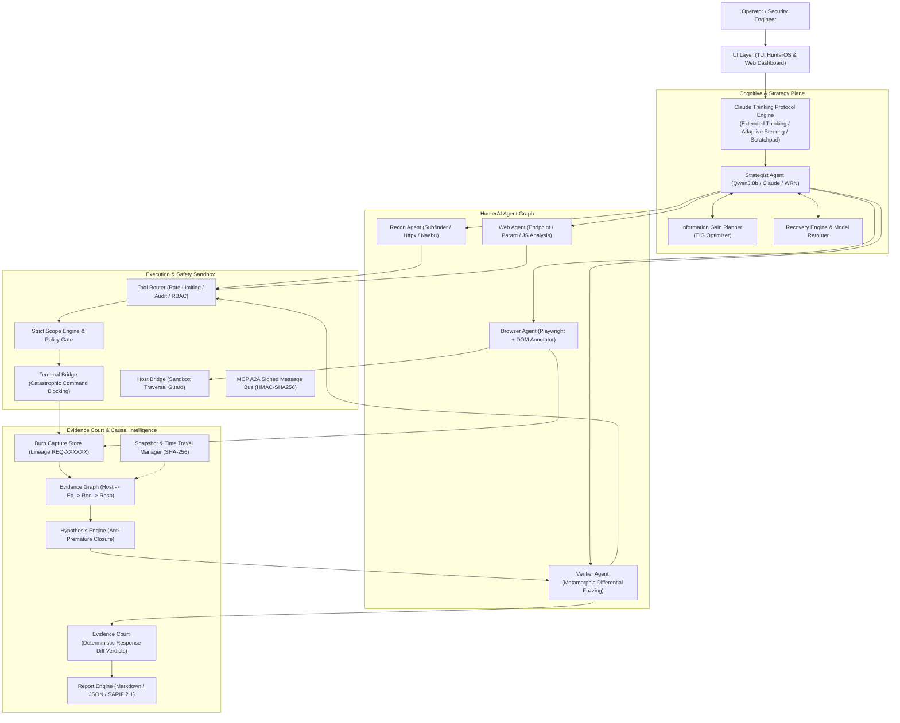

# HunterAI OS — System Architecture & Design Specification

HunterAI is an enterprise-grade **Security Assessment Operating System** engineered around evidence-first causality, deterministic verification, human-like cognitive reasoning (Anthropic Claude Thinking Protocol), and sandboxed execution.

---

## 1. High-Level Architecture Diagram

---

## 2. Core Architectural Pillars

### A. Cognitive Thinking Layer (Anthropic Claude Extended Thinking)
HunterAI implements the Anthropic Extended Thinking architecture:
- **Inner Monologue Scratchpad:** Raw, stream-of-consciousness reasoning inside `<thinking>` blocks before any action is executed.
- **Adaptive Thinking Framework:** Scales cognitive effort parameter ($0.0 \le \text{effort} \le 1.0$) and token ceiling ($1\text{k} - 16\text{k}$ tokens) depending on task complexity and stakes.
- **8-Stage Cognitive Sequence:** Initial Engagement $\to$ Problem Decomposition $\to$ Multiple Competing Hypotheses $\to$ Detective Discovery $\to$ Pre-Tool Reflection $\to$ Post-Tool Reflection $\to$ Error Course Correction $\to$ Strategic Meta-Cognition.
- **Anti-Premature Closure:** Requires maintaining multiple competing hypotheses (e.g. IDOR vs Public Data vs Caching Anomaly) rather than confirmation bias.

### B. Evidence Court & Zero LLM Hallucination
- **Deterministic Response Diff Rules:** LLMs generate hypotheses and execution commands, but are strictly forbidden from deciding vulnerability verdicts.
- **Court Adjudication:** Verdicts (`CONFIRMED`, `REJECTED`, `INCONCLUSIVE`) are awarded strictly by deterministic differential verification ($A/B$ testing, status code diffs, payload length thresholds, PoE token reflection).

### C. Hard Scope Enforcement & Sandboxing
- **Inviolable Scope Engine:** Blocks localhost, loopback (`127.0.0.1`), metadata services (`169.254.169.254`), and unauthorized hostnames at the network and process level.
- **Terminal Bridge:** Intercepts and denies catastrophic commands (`rm -rf /`, fork bombs, mkfs, dd). Automatically masks secrets, bearer tokens, and API credentials from all outputs.

### D. Time Travel & Resilience
- **State Snapshots:** Full checkpoint captures with SHA-256 integrity hashes for instantaneous rollback.
- **Recovery Engine:** Autonomous rerouting to fallback model tiers, automatic tool process restarts, and exponential-backoff retries for network fluctuations.
